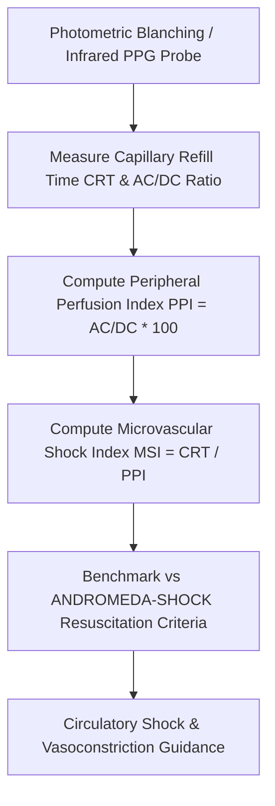

# Cutaneous Capillary Refill Time (CRT) & Peripheral Perfusion Index (PPI) Skill

[](LICENSE)
[](https://www.python.org/)
[](https://modelcontextprotocol.io/)
[](requirements.txt)
[](https://github.com/alphaparkinc)

A zero-dependency, mathematically rigorous personal agent skill that computes cutaneous capillary refill time, pulse oximetry perfusion index, and microvascular shock indices to evaluate peripheral tissue perfusion.

## Architecture



## Quick Start

```python
from client import CapillaryRefillPerfusionClient

client = CapillaryRefillPerfusionClient()
result = client.evaluate_microvascular_perfusion(
    capillary_refill_time_seconds=1.7,
    pulsatile_ac_signal=22.0,
    baseline_dc_signal=1000.0
)
print("CRT (s):", result["microvascular_metrics"]["capillary_refill_time_crt_seconds"])
print("PPI (%):", result["microvascular_metrics"]["peripheral_perfusion_index_ppi_pct"])
print("Status:", result["perfusion_assessment"]["perfusion_state"])
```

## License
Apache-2.0
